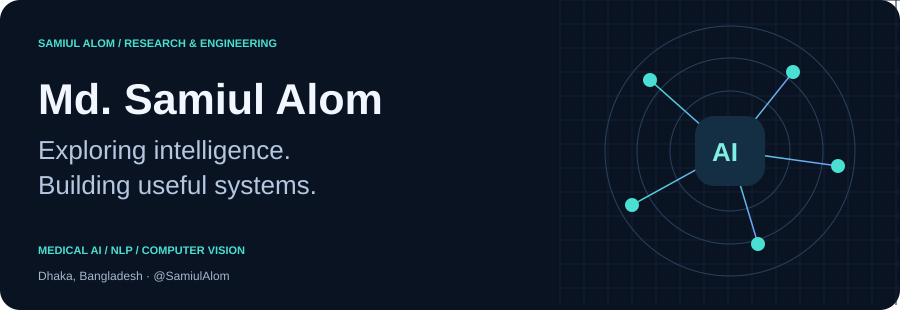

<a href="https://www.linkedin.com/in/samiul-alom-087124227/"><strong>LINKEDIN ↗</strong></a> &nbsp; · &nbsp; <a href="https://github.com/SamiulAlom?tab=repositories"><strong>ALL PROJECTS ↗</strong></a> &nbsp; · &nbsp; <a href="https://github.com/SamiulAlom/SamiulAlom/actions/workflows/profile.yml"><strong>STATS WORKFLOW ↗</strong></a>

### 👨‍💻 About me

### Turning curiosity into useful systems.

I'm **Md. Samiul Alom**, a Computer Science graduate and **Adjunct Research Associate at Miyan Research Institute**, based in Dhaka, Bangladesh. My research focuses on **trustworthy AI for healthcare**: uncertainty estimation, calibration, domain generalization, explainability and federated learning. I also build practical web applications and mentor students in research and development.

[Google Scholar](https://scholar.google.com/citations?user=aulykMwAAAAJ&hl=en) · [LinkedIn](https://www.linkedin.com/in/samiul-alom-087124227/) · [Email](mailto:samiulalom090@gmail.com)

### 🎓 Education & experience

| Role / qualification | Institution | Period |
|:--|:--|:--|
| **B.Sc. in Computer Science and Engineering** · CGPA **3.74/4.00** | International University of Business Agriculture and Technology (IUBAT) | Jan 2022–Jan 2026 |
| **Adjunct Research Associate** | Miyan Research Institute | Feb 2026–present |
| **Advanced Web Development & AI — mentoring/teaching** · 53 students | IUBAT | May–Jul 2024 |
| **Web Development & Design — mentoring/teaching** · 30 students | IUBAT | Jun–Aug 2023 |

**Thesis:** *An Explainable Triple-Layered Ensemble Model for Early Prediction of Suicide Risk Using Machine Learning.* Related work was published in **Engineering Reports**.

### 🔭 Current research focus

- **Trustworthy medical imaging:** skin lesions, fetal ultrasound biometry, thyroid classification and breast ultrasound segmentation.
- **Reliable deployment:** calibration, uncertainty estimation, selective prediction and domain generalization.
- **Explainable healthcare prediction:** ensemble methods for suicide risk, stroke, heart disease and thyroid-cancer recurrence.
- **Privacy-aware learning:** decentralized XGBoost and federated cardiovascular-risk modeling.
- **Language research:** transformer-based Bangla text classification and sentiment analysis.

### 🚀 Featured projects

   

Project illustrations are abstract design elements, not model outputs or research results.

### 🛠️ Tech stack

**Programming** · Python · C · C++ · JavaScript  
**Machine learning & data** · scikit-learn · pandas · NumPy · Ensemble learning  
**Deep learning** · PyTorch · TensorFlow · Keras · CNNs · Vision transformers  
**Trustworthy AI** · SHAP · LIME · Grad-CAM · Calibration · Uncertainty estimation  
**Web & tools** · React · Next.js · Git · Google Colab · Jupyter Notebook

### 📊 GitHub stats

Refreshed daily. Contribution activity follows GitHub's rolling-year calendar and visibility rules. Language counts describe public, non-fork repositories—not skill levels.

### 📄 Selected journal publications

1. **Stroke Prediction Using Ensemble Machine and Deep Learning Models** — *Biomedical Materials & Devices*, Springer Nature, 2025. **First author.** [DOI](https://doi.org/10.1007/s44174-025-00521-z)
2. **A novel dataset of North-Eastern Indian coins for machine learning-based classification** — *Data in Brief*, Elsevier, 2026, article 112813. Co-author.
3. **An explainable triple-layered ensemble model for early prediction of suicide risk using machine learning** — *Engineering Reports*, Wiley, 8(1), e70574. Online publication 2025; issue 2026. **First author.**

[View publication record on Google Scholar ↗](https://scholar.google.com/citations?user=aulykMwAAAAJ&hl=en)

### 📰 Accepted / forthcoming

**SkinNet: Explainable Lightweight CNN Model for Skin Disease Classification** — *Foundations of Computing and Decision Sciences*. Third author. **Accepted / forthcoming.**

<strong>🔬 Four manuscripts under review</strong>

These manuscripts are under review, not accepted publications.

| Manuscript | Submitted venue |
|:--|:--|
| **MAD-Seg:** Learning Consensus, Boundaries, and Human Disagreement for Skin Lesion Segmentation | International Journal of Intelligent Systems |
| **Geometry-Supervised Fetal Ultrasound Biometry Under Cross-Center Distribution Shift:** A Capacity-Controlled Evaluation | Advanced Intelligent Systems |
| **TrustDG-BUS:** Source-Only Domain Generalization and Selective Deployment for Breast Ultrasound Lesion Segmentation | International Journal of Intelligent Systems |
| **ThyTrust-MD:** Lesion-Supervised Thyroid Ultrasound Classification with Calibrated Uncertainty and Explainability | Array |

<strong>🌐 Selected international conference publications</strong>

- **Federated Machine Learning for Cardiovascular Risk Assessment: A Decentralized XGBoost Approach** — IEEE QPAIN, 2025. **First author.**
- **Enhanced Heart Disease Prediction Using Advanced Classifiers and Ensemble Learning Techniques** — IEEE ECCE, 2025. **First author.**
- **Multiclass Detection of Misogynistic Bangla Text from YouTube Using Transformer-Based Models** — IEEE ECCE, 2025. Co-author.
- **Enhancing sleep disorder diagnosis with a machine learning approach using ensemble neural networks** — 11th International Conference on Networking, Systems, and Security, 2024. **First author.**
- **Boosted Forest Soft Ensemble of XGBoost, Gradient Boosting, and Random Forest with Explainable AI for Thyroid Cancer Recurrence Prediction** — IEEE QPAIN, 2025. Co-author.

### 🏆 Leadership, mentoring & community

- **Advisor, IUBAT IEEE Computer Society:** student activities, technical workshops and research mentoring.
- **Microsoft Beta Student Ambassador (2023–2025):** organized four international online events on cloud and developer tools; delivered a seminar on international student opportunities to **250+ students**.
- **Research seminar speaker:** delivered *From Idea to Impact: A Complete Research Journey in AI, Publishing, and Innovation*, a **1.5-hour seminar for 350+ students and faculty**.
- **Executive Member, Hult Prize at IUBAT** and **Postman Student Leader**.
- **IEEE Member** and **IEEE Computer Society Member**.
- Collaborated with **8+ faculty members** on experiments, evaluation and manuscripts; also mentored C/C++ classes in Fall 2024.

### 💬 Let's connect

*From an interesting question to something useful.*

The profile-view badge is a third-party image counter, not a unique-visitor count. Stats and streaks are generated in this repository.

  

