<a href="https://github.com/SamiulAlom"><picture><source media="(prefers-color-scheme: light)" srcset="./assets/light/hero.svg"></picture></a>

   

I build trustworthy AI for healthcare and practical web apps — models that are calibrated, explainable and honest about uncertainty, and software that people actually use.

<b>Working on now:</b> <a href="https://github.com/SamiulAlom/Brilliancy_appointment_system">Brilliancy_appointment_system</a> (1d ago) · <a href="https://github.com/SamiulAlom/Daily_activity_track">Daily_activity_track</a> (1w ago) · <a href="https://github.com/SamiulAlom/FetalGeo">FetalGeo</a> (1mo ago)

## Featured projects

### Medical imaging
Segmentation and classification with calibration, uncertainty and explainability built in.

<a href="https://github.com/SamiulAlom/Skin-Lesion"><picture><source media="(prefers-color-scheme: light)" srcset="./assets/light/projects/Skin-Lesion.svg"></picture></a>
<a href="https://github.com/SamiulAlom/Breast-Segmentation"><picture><source media="(prefers-color-scheme: light)" srcset="./assets/light/projects/Breast-Segmentation.svg"></picture></a>
<a href="https://github.com/SamiulAlom/thyroid-segmentation"><picture><source media="(prefers-color-scheme: light)" srcset="./assets/light/projects/thyroid-segmentation.svg"></picture></a>
<a href="https://github.com/SamiulAlom/FetalGeo"><picture><source media="(prefers-color-scheme: light)" srcset="./assets/light/projects/FetalGeo.svg"></picture></a>
<a href="https://github.com/SamiulAlom/Gastrointestinal"><picture><source media="(prefers-color-scheme: light)" srcset="./assets/light/projects/Gastrointestinal.svg"></picture></a>

### Healthcare prediction & Bangla NLP
Explainable ensembles for clinical risk, and transformer models for Bangla text.

<a href="https://github.com/SamiulAlom/Suicide-prediction"><picture><source media="(prefers-color-scheme: light)" srcset="./assets/light/projects/Suicide-prediction.svg"></picture></a>
<a href="https://github.com/SamiulAlom/Thyroid-cancer-prediction"><picture><source media="(prefers-color-scheme: light)" srcset="./assets/light/projects/Thyroid-cancer-prediction.svg"></picture></a>
<a href="https://github.com/SamiulAlom/Hate-speech"><picture><source media="(prefers-color-scheme: light)" srcset="./assets/light/projects/Hate-speech.svg"></picture></a>
<a href="https://github.com/SamiulAlom/crime-detection"><picture><source media="(prefers-color-scheme: light)" srcset="./assets/light/projects/crime-detection.svg"></picture></a>

### Apps & products
Full-stack software, from farming assistants to booking platforms.

<a href="https://github.com/SamiulAlom/Brilliancy_appointment_system"><picture><source media="(prefers-color-scheme: light)" srcset="./assets/light/projects/Brilliancy_appointment_system.svg"></picture></a>
<a href="https://github.com/SamiulAlom/AgroAI_Project"><picture><source media="(prefers-color-scheme: light)" srcset="./assets/light/projects/AgroAI_Project.svg"></picture></a>
<a href="https://github.com/SamiulAlom/agri_AI"><picture><source media="(prefers-color-scheme: light)" srcset="./assets/light/projects/agri_AI.svg"></picture></a>
<a href="https://github.com/SamiulAlom/Daily_activity_track"><picture><source media="(prefers-color-scheme: light)" srcset="./assets/light/projects/Daily_activity_track.svg"></picture></a>
<a href="https://github.com/SamiulAlom/sust-bank-loan-project"><picture><source media="(prefers-color-scheme: light)" srcset="./assets/light/projects/sust-bank-loan-project.svg"></picture></a>

<b>All other repositories (57)</b> — auto-listed, newest first

| Repository | What it is | Language | ★ | Updated |
|:--|:--|:--|:-:|:--|
| [Ai_eng1](https://github.com/SamiulAlom/Ai_eng1) | Flask patient API with a database layer | Python | 0 | 3mo ago |
| [Semantic-Sentence](https://github.com/SamiulAlom/Semantic-Sentence) | 3-class Bangla semantic sentence classification, 5-fold CV | Jupyter Notebook | 0 | 5mo ago |
| [News-Classification](https://github.com/SamiulAlom/News-Classification) | Bangla news classification with multilingual BERT | Jupyter Notebook | 0 | 5mo ago |
| [Liver-Disease-Prediction-](https://github.com/SamiulAlom/Liver-Disease-Prediction-) | Liver disease prediction with a tuned XGBoost voting ensemble | Jupyter Notebook | 0 | 5mo ago |
| [Hepatics-C-Prediction-](https://github.com/SamiulAlom/Hepatics-C-Prediction-) | Hepatitis C prediction with SMOTE, boosting and calibration curves | Jupyter Notebook | 0 | 5mo ago |
| [semantic](https://github.com/SamiulAlom/semantic) | Bangla semantic dataset and baseline notebook | Jupyter Notebook | 0 | 1y ago |
| [Student-Depression-Detection-Dataset](https://github.com/SamiulAlom/Student-Depression-Detection-Dataset) | Student depression detection dataset | — | 0 | 1y ago |
| [Library-management](https://github.com/SamiulAlom/Library-management) | C# .NET library management API | C# | 0 | 1y ago |
| [depression](https://github.com/SamiulAlom/depression) | Depression detection experiments | Jupyter Notebook | 0 | 1y ago |
| [fetal-health](https://github.com/SamiulAlom/fetal-health) | Fetal health classification: ANN, AdaBoost, GB, KNN, SVM | Jupyter Notebook | 0 | 2y ago |
| [sleep-disorder](https://github.com/SamiulAlom/sleep-disorder) | Sleep disorder diagnosis with an ANN ensemble | Jupyter Notebook | 0 | 2y ago |
| [DenguePredictionDeep](https://github.com/SamiulAlom/DenguePredictionDeep) | Dengue prediction: ANN, CNN, RF, SVM, KNN, logistic regression | Jupyter Notebook | 0 | 2y ago |
| [reactTest](https://github.com/SamiulAlom/reactTest) | JavaScript project | JavaScript | 0 | 2y ago |
| [IUBAT-Canteen](https://github.com/SamiulAlom/IUBAT-Canteen) | PHP + MySQL canteen ordering site with registration | PHP | 0 | 2y ago |
| [database](https://github.com/SamiulAlom/database) | Repository | — | 0 | 2y ago |
| [Sust_Hacathon](https://github.com/SamiulAlom/Sust_Hacathon) | SUST hackathon front end | CSS | 0 | 2y ago |
| [skills-review-pull-requests](https://github.com/SamiulAlom/skills-review-pull-requests) | My clone repository | HTML | 0 | 3y ago |
| [ninish-project](https://github.com/SamiulAlom/ninish-project) | JavaScript web project | JavaScript | 1 | 3y ago |
| [react-todoApp](https://github.com/SamiulAlom/react-todoApp) | React to-do app | JavaScript | 0 | 3y ago |
| [react-simple-app](https://github.com/SamiulAlom/react-simple-app) | Early web-development practice | JavaScript | 0 | 3y ago |
| [Daynamic-shoping-card](https://github.com/SamiulAlom/Daynamic-shoping-card) | Dynamic shopping cart in JavaScript | JavaScript | 0 | 3y ago |
| [mlsaProtfolio](https://github.com/SamiulAlom/mlsaProtfolio) | Microsoft Student Ambassador portfolio | JavaScript | 0 | 3y ago |
| [codespaces-project](https://github.com/SamiulAlom/codespaces-project) | Early web-development practice | JavaScript | 0 | 3y ago |
| [Portfolio](https://github.com/SamiulAlom/Portfolio) | Personal portfolio site in React | JavaScript | 0 | 3y ago |
| [js-problem](https://github.com/SamiulAlom/js-problem) | Early web-development practice | HTML | 0 | 3y ago |
| [iits-js-course-summner23](https://github.com/SamiulAlom/iits-js-course-summner23) | Early web-development practice | HTML | 0 | 3y ago |
| [Book_Shop](https://github.com/SamiulAlom/Book_Shop) | Book shop storefront | HTML | 1 | 3y ago |
| [Chat-Application](https://github.com/SamiulAlom/Chat-Application) | React real-time chat app with authentication | JavaScript | 1 | 3y ago |
| [chatbot_web_railway](https://github.com/SamiulAlom/chatbot_web_railway) fork | Contextual chatbot web app using Django (fork) | — | 0 | 3y ago |
| [NonAcademy-P2](https://github.com/SamiulAlom/NonAcademy-P2) | Early web-development practice | CSS | 0 | 3y ago |
| [NonAcademy-P1](https://github.com/SamiulAlom/NonAcademy-P1) | Early web-development practice | CSS | 0 | 3y ago |
| [quiz-app](https://github.com/SamiulAlom/quiz-app) | Quiz app with login, timed quiz and results | JavaScript | 0 | 3y ago |
| [react-mantra](https://github.com/SamiulAlom/react-mantra) | Early web-development practice | JavaScript | 0 | 3y ago |
| [my-app](https://github.com/SamiulAlom/my-app) | Early web-development practice | JavaScript | 0 | 3y ago |
| [shopping-Card](https://github.com/SamiulAlom/shopping-Card) | Early web-development practice | HTML | 0 | 3y ago |
| [Bank](https://github.com/SamiulAlom/Bank) | Early web-development practice | JavaScript | 0 | 3y ago |
| [css_gird](https://github.com/SamiulAlom/css_gird) | Early web-development practice | HTML | 0 | 3y ago |
| [coffe_site](https://github.com/SamiulAlom/coffe_site) | Coffee shop landing page | HTML | 1 | 4y ago |
| [Pasword_generator](https://github.com/SamiulAlom/Pasword_generator) | Random password generator | CSS | 2 | 4y ago |
| [Class_Report_card](https://github.com/SamiulAlom/Class_Report_card) | Class report card generator | JavaScript | 1 | 4y ago |
| [Attandance_beta](https://github.com/SamiulAlom/Attandance_beta) | Attendance tracker prototype | HTML | 2 | 4y ago |
| [String_variation](https://github.com/SamiulAlom/String_variation) | Early web-development practice | CSS | 1 | 4y ago |
| [job1](https://github.com/SamiulAlom/job1) | Early web-development practice | JavaScript | 0 | 5y ago |
| [landingPage-4](https://github.com/SamiulAlom/landingPage-4) | Early web-development practice | CSS | 0 | 5y ago |
| [landingPage-3](https://github.com/SamiulAlom/landingPage-3) | Early web-development practice | CSS | 0 | 5y ago |
| [landingPage_2](https://github.com/SamiulAlom/landingPage_2) | Early web-development practice | CSS | 0 | 5y ago |
| [landingPage-1](https://github.com/SamiulAlom/landingPage-1) | Early web-development practice | HTML | 0 | 5y ago |
| [work-7](https://github.com/SamiulAlom/work-7) | Early web-development practice | HTML | 1 | 5y ago |
| [work-6](https://github.com/SamiulAlom/work-6) | Early web-development practice | HTML | 1 | 5y ago |
| [design_5](https://github.com/SamiulAlom/design_5) | Early web-development practice | HTML | 0 | 5y ago |
| [design-4](https://github.com/SamiulAlom/design-4) | Early web-development practice | HTML | 1 | 5y ago |
| [design_3](https://github.com/SamiulAlom/design_3) | Early web-development practice | HTML | 1 | 5y ago |
| [design-2](https://github.com/SamiulAlom/design-2) | Early web-development practice | HTML | 1 | 5y ago |
| [design-1](https://github.com/SamiulAlom/design-1) | Early web-development practice | HTML | 1 | 5y ago |
| [homework-1](https://github.com/SamiulAlom/homework-1) | Early web-development practice | HTML | 0 | 5y ago |
| [homework-2](https://github.com/SamiulAlom/homework-2) | Early web-development practice | HTML | 0 | 5y ago |
| [react-quiz](https://github.com/SamiulAlom/react-quiz) fork | React quiz application (fork) | — | 0 | 5y ago |

## Tech stack

              

## GitHub stats

<picture><source media="(prefers-color-scheme: light)" srcset="./assets/light/stats.svg"></picture>

<picture><source media="(prefers-color-scheme: light)" srcset="./assets/light/languages.svg"></picture>

<picture><source media="(prefers-color-scheme: light)" srcset="./assets/light/heatmap.svg"></picture>

<picture><source media="(prefers-color-scheme: light)" srcset="./assets/light/streaks.svg"></picture>

<picture><source media="(prefers-color-scheme: light)" srcset="./assets/light/trend.svg"></picture>

## Recent activity

| When | What |
|:--|:--|
| 2d ago | Pushed to [SamiulAlom](https://github.com/SamiulAlom/SamiulAlom) |
| 4d ago | Open-sourced [Brilliancy_appointment_system](https://github.com/SamiulAlom/Brilliancy_appointment_system) |
| 1w ago | Open-sourced [Daily_activity_track](https://github.com/SamiulAlom/Daily_activity_track) |
| 1w ago | Starred [Daily_activity_track](https://github.com/SamiulAlom/Daily_activity_track) |
| 1w ago | Starred [SamiulAlom](https://github.com/SamiulAlom/SamiulAlom) |
| 1w ago | Pushed to [SamiulAlom](https://github.com/SamiulAlom/SamiulAlom) |

---
This profile rebuilds itself every 6 hours from the GitHub API — last run <b>30 Oct 2026, 12:51 UTC</b>. Project names and features live in <a href="./profile.json">profile.json</a>; everything else is automatic. <a href="https://github.com/SamiulAlom/SamiulAlom/actions/workflows/profile.yml">Workflow ↗</a>
